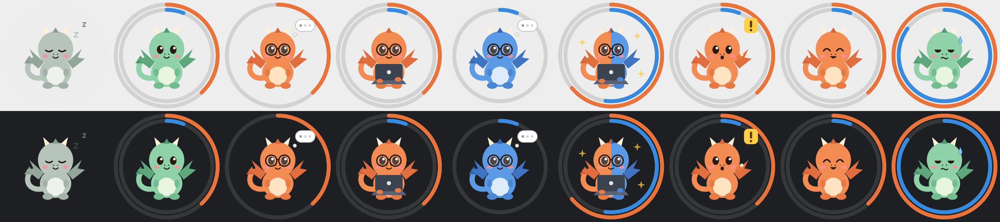
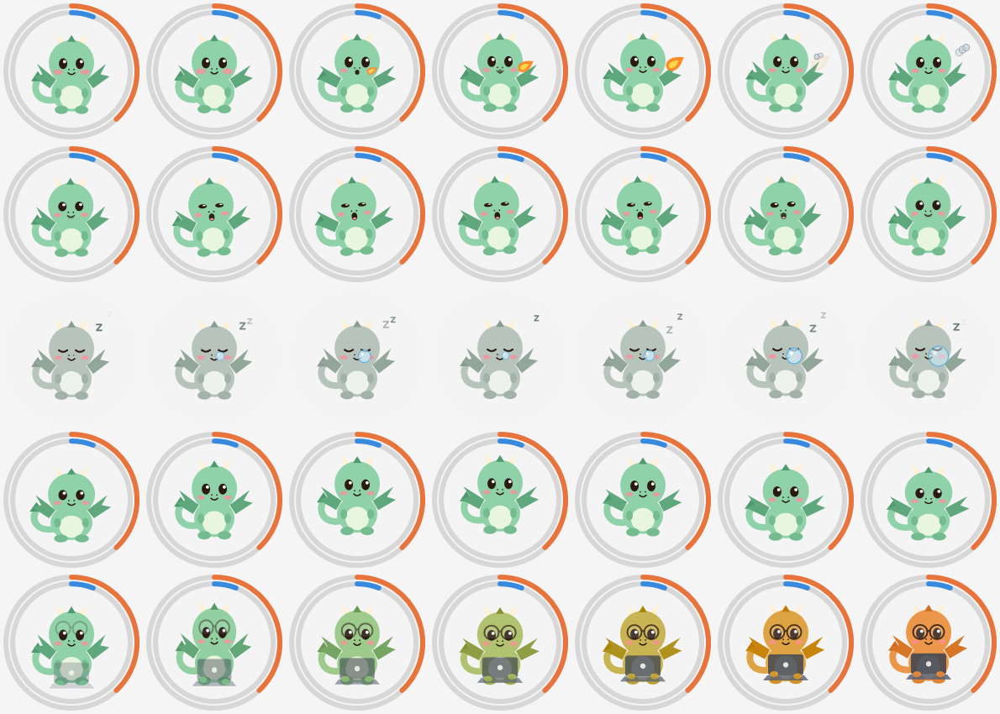

# Hoardling

A tiny dragon that lives on your Windows desktop. Dragons guard their hoard; this little one
guards yours. It keeps an eye on your **Claude** and **Antigravity** usage limits, and it wakes up
and gets to work whenever either of them does.

I wanted a little desk buddy like the pet in Codex, except a dragon, and one that would also tell
me how close I was to hitting my limits. So here it is.



> This is a hobby project. It isn't affiliated with, endorsed by or supported by Anthropic or
> Google. It reads a few undocumented endpoints, so it can break whenever they change (more on
> that in [Data sources](#data-sources)).
>
> Heads up: the pet's own interface (hover card, tray menu) is in Spanish for now.

## What it shows

- **Rings.** The outer, orange ring is your Claude 5-hour session. The inner, blue one is
  whichever Antigravity 5-hour limit you've used the most (Gemini or Claude/GPT). A ring only
  shows up while its app is open on this PC: if it's closed, you might be using that limit from
  your phone or another computer, and the dragon would just be showing you an old number. An
  empty grey ring means the app is open but the data hasn't come in yet.
- **Hover card.** Hover over the dragon for the details: weekly limits, every Antigravity group
  and how long until each one resets. Same rule as the rings, it only lists the apps that are
  open.
- **Moods:**

  | The dragon… | Means |
  |---|---|
  | sleeps (grey, "z z", no rings) | neither Claude nor Antigravity is open |
  | is mint green | they're open and idle |
  | turns orange and puts on glasses | Claude Code is thinking or typing |
  | turns blue and puts on glasses | Antigravity is working |
  | is half orange, half blue | both are working at the same time |
  | raises a hand with a "!" | Claude Code wants permission or is asking you something |
  | hops happily | one of them just finished |
  | sweats | a 5-hour limit is at 80 % or more |
  | looks exhausted | a limit is at 100 % |

- **Little gestures** every now and then, depending on its mood:
  - **Idle:** looks around, wags its tail, stretches its wings, yawns, hops or **burps a tiny
    flame**. Leave it alone for a couple of minutes and it gets bored: more yawns, more fire.
  - **Asleep:** a snore bubble that grows until it pops, smoke puffs from its nose, some
    mumbling, tail twitches, a stretch.
  - **Working:** looks up while it thinks, pushes its glasses up, types faster.
  - **Needs you:** waves at you.
- **Nothing just snaps into place.** Accessories slide in and out, faces and colours fade into
  each other (blended in OKLCh, so green to orange passes through gold instead of mud), and every
  change gets a little squash and stretch.



## What you need

- Windows 10 or 11, x64.
- The [.NET 10 Desktop Runtime](https://dotnet.microsoft.com/download/dotnet/10.0) to run it, or
  the .NET 10 SDK to build it.
- For Claude data: [Claude Code](https://docs.claude.com/en/docs/claude-code), signed in at least
  once from a terminal (`claude`, then `/login`).
- For Antigravity data: just have Antigravity open.

## Build and run

```bash
dotnet publish src/Hoardling -c Release -r win-x64 --self-contained false -p:PublishSingleFile=true -p:DebugType=none -o dist
```

```bash
dist/Hoardling.exe
```

The dragon shows up in the bottom-right corner. Drag it wherever you like and it'll remember the
spot. If you start it from a terminal, an editor or Claude Code, it detaches itself, so closing
those won't take the dragon down with them.

Click its tray icon (next to the clock) to hide or show it, start it with Windows, turn the
Claude Code hooks on or off, or quit.

## What it changes on your PC

I'd want to know this before running something like it, so here's everything it touches:

- **`~/.claude/settings.json`** (only if `~/.claude` exists, i.e. Claude Code is installed):
  while the dragon is running it adds HTTP hooks that ping it (on `127.0.0.1:47823`) when Claude
  Code thinks, uses a tool, asks for permission or finishes. It takes them out again when it
  quits, leaving the file the way it was. The first time, it saves a backup as
  `settings.json.hoardling.bak`.
- **`~/.claude/.credentials.json`**: it reads Claude Code's OAuth token to check your usage. When
  the token expires it refreshes it the same way Claude Code does, and writes back only the token
  fields, atomically. Tokens are never logged or printed.
- **A local HTTP listener on `127.0.0.1:47823`**: loopback only, so nothing on your network can
  reach it. It only accepts `POST /hoardling` with a loopback `Host` and no `Origin` header, which
  means a web page open in your browser can't feed it fake events.
- **`~/.gemini/antigravity/daemon/`**: it reads (never writes) the little files Antigravity leaves
  there so local tools can find its language server: the port and a local token.
- **WMI**: on Antigravity versions older than 2.34, which don't leave those files, it asks
  `Win32_Process` where the language server is instead. When you start it from a terminal, an
  editor or Claude Code, it also calls `Win32_Process.Create` once to relaunch itself outside the
  launcher's job. Some security tools
  may flag that second call; it's only the dragon restarting itself. Antigravity's self-signed
  certificate is accepted for `127.0.0.1` only.
- **`%APPDATA%\Hoardling\settings.json`**: where it remembers its spot and your preferences.
- **`%LOCALAPPDATA%\Hoardling\state.log`**: only if you start it with `--log`.
- **Start with Windows** (only if you turn it on): a `Hoardling` value under
  `HKCU\Software\Microsoft\Windows\CurrentVersion\Run`.

One catch: if the dragon gets killed abruptly (from Task Manager, say), its hooks stay in
`settings.json` and Claude Code shows a harmless "hook error" on every event until you start the
dragon again (or untick the hooks option in the tray menu).

## Uninstall

1. In the tray menu, untick **start with Windows** if you turned it on, then quit. Quitting takes
   the hooks out of `~/.claude/settings.json`.
2. Delete `Hoardling.exe`, `%APPDATA%\Hoardling` and, if they're there, `%LOCALAPPDATA%\Hoardling`
   and `~/.claude/settings.json.hoardling.bak`.

## Data sources

None of these are documented, so if one of them changes, its ring just turns grey. Claude's usage
is only checked while Claude is open.

| Data | Source |
|---|---|
| Claude limits | `GET https://api.anthropic.com/api/oauth/usage` with Claude Code's OAuth token |
| Claude token refresh | `POST https://platform.claude.com/v1/oauth/token` |
| Claude activity | Claude Code hooks posted to `http://127.0.0.1:47823/hoardling` |
| Antigravity limits and activity | Antigravity's local language server (`127.0.0.1`), found through `~/.gemini/antigravity/daemon/` (or its process, before 2.34) |

Nothing else leaves your machine. No telemetry, no other servers.

## Command line

| Option | What it does |
|---|---|
| `--quit` | Closes the running dragon cleanly and removes its hooks. |
| `--log` | Writes state changes and received hooks to `%LOCALAPPDATA%\Hoardling\state.log` (no tokens, no conversation content). |
| `--probe-ag` | Prints what it reads from Antigravity: quota and activity. |
| `--render-states <file.png>` | Draws every mood into one image. |
| `--render-transitions <file.png>` | Draws frames of the colour blends. |
| `--render-gestures <file.png>` | Draws frames of every gesture and mood change. |

## Hacking on it

It's .NET 10 and WPF. `src/Hoardling.Core` has the logic you can test (parsers, activity
trackers, the state machine, the hook server, scheduling, colour and motion maths), and
`src/Hoardling` has the Windows side (windows, tray, rendering, finding Antigravity).

```bash
dotnet test
```

The design notes, the plan and the quality audits (in Spanish) are in `docs/superpowers/`. The
independent code reviews done with Antigravity (Gemini) are in `help-by-AG/`.

Down the road I'd like it to become a companion for any coding agent (Codex, OpenCode and
friends), not just these two.

## License

[MIT](LICENSE)
